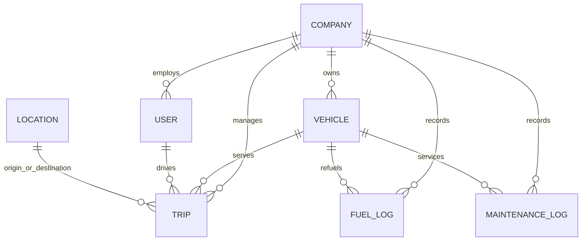

# Fleet Economics API

<p align="center"></p>
<p align="center"><strong>REST API для обліку автопарку мікроперевізників і аналізу економіки рейсів.</strong></p>

**Fleet Economics API** допомагає компаніям обліковувати автомобілі, рейси, заправки й технічне обслуговування. На основі цих первинних даних API обчислює собівартість кілометра, прибуток рейсу, завантаженість, CASK та RASK.

Проєкт виконано як семестрову роботу в межах **Lab 21 — The Backend Behind Every App: A REST API with Real Auth**. Його фокус — практики, очікувані від сучасного backend: валідація, міграції, JWT-автентифікація, контроль доступу за ролями, ізоляція даних та тести.

## Зміст

- [Можливості](#можливості)
- [Технології](#технології)
- [Архітектура](#архітектура-та-модель-даних)
- [Швидкий старт](#швидкий-старт)
- [API](#api)
- [Тестування](#тестування)
- [Наступні кроки](#поточні-обмеження-та-наступні-кроки)

## Можливості

- Реєстрація компанії та її першого адміністратора.
- Вхід за email і паролем із видачею JWT access token.
- Хешування паролів за допомогою **Argon2id**.
- Мультитенантність: дані кожної компанії ізольовані через `company_id`.
- Ролі `admin`, `dispatcher` і `driver` з різним рівнем доступу.
- Облік автомобілів, рейсів, заправок і технічного обслуговування.
- Пагінація через `skip` і `limit`; сортування рейсів.
- Soft delete для користувачів та автомобілів.
- Довідник локацій і синхронізація ринкових цін на пальне з Minfin (для адміністратора).
- Розрахунок вартості кілометра, прибутку рейсу, load factor, CASK і RASK.
- Інтерактивна OpenAPI-документація, яку FastAPI генерує автоматично.

## Технології

| Напрям | Використано |
| --- | --- |
| Мова та вебфреймворк | Python 3.11+, FastAPI |
| Валідація | Pydantic v2 |
| ORM | SQLAlchemy 2 |
| Бази даних | SQLite для локальної розробки, PostgreSQL-сумісна конфігурація для production |
| Міграції | Alembic |
| Автентифікація | JWT (HS256), OAuth2 Password Flow |
| Хешування паролів | pwdlib / Argon2id |
| Тестування | pytest + httpx |
| API-документація | OpenAPI / Swagger UI |

## Архітектура та модель даних

Маршрути обробляють HTTP-запити, Pydantic-схеми перевіряють дані, SQLAlchemy-моделі працюють із БД, а `EconomicsService` містить бізнес-розрахунки.

```text
Client → FastAPI router → authentication / RBAC → service or ORM → database
```

Кожна компанія — окремий tenant. Ідентифікатор компанії не приймається в тілі запиту для tenant-owned ресурсів: він визначається з JWT поточного користувача. Для рейсів, записів ТО і заправок додатково передбачені обмеження зовнішніх ключів, що не дозволяють пов'язати сутності різних компаній.



Детальна ER-діаграма: [docs/er_diagram.png](docs/er_diagram.png).

### Ролі

| Роль | Основні можливості |
| --- | --- |
| `admin` | Керує працівниками, автопарком, рейсами та цінами на пальне. |
| `dispatcher` | Керує автопарком і рейсами; може створювати водіїв. |
| `driver` | Бачить власні рейси та призначені автомобілі, може додавати записи для них. |

### Економічні метрики

Грошові значення зберігаються у **копійках**, що уникає похибок `float` під час збереження коштів. Метрики обчислюються динамічно й не дублюють первинні дані в БД.

```text
Revenue = ticket_price × passengers_carried
Depreciation per km = (purchase_price − residual_value) / expected_life_km
Load Factor = passengers_carried / passenger_capacity
ASK = distance_km × passenger_capacity
RASK = revenue / ASK
CASK = estimated_costs / ASK
Profit = revenue − estimated_costs
```

Вартість кілометра включає амортизацію, орієнтовну вартість пального та витрати на технічне обслуговування.

## Швидкий старт

### Передумови

- Python 3.11 або новіший;
- `pip`;
- Git.

### 1. Клонувати репозиторій

```bash
git clone https://github.com/ya-sa-29/fleet-economics-api.git
cd fleet-economics-api
```

### 2. Створити й активувати віртуальне середовище

**Windows (PowerShell):**

```powershell
python -m venv .venv
.\.venv\Scripts\Activate.ps1
```

**Linux / macOS:**

```bash
python3 -m venv .venv
source .venv/bin/activate
```

### 3. Встановити залежності та налаштувати оточення

```bash
pip install -r requirements.txt
cp .env.example .env
```

Для Windows CMD використовуйте `copy .env.example .env`.

Задайте безпечний секрет у `.env`. Цей файл не має потрапляти до Git.

```dotenv
DATABASE_URL=sqlite:///./fleet.db
JWT_SECRET_KEY=replace-with-a-long-random-secret
```

> Для production використовуйте окрему секретну змінну середовища й PostgreSQL URL. Не застосовуйте демонстраційне значення з `.env.example`.

### 4. Застосувати міграції та додати початкові локації

```bash
alembic upgrade head
python seed.py
```

### 5. Запустити сервер

```bash
uvicorn src.main:app --reload
```

- API: <http://127.0.0.1:8000>
- Swagger UI: <http://127.0.0.1:8000/docs>
- ReDoc: <http://127.0.0.1:8000/redoc>
- Health check: <http://127.0.0.1:8000/health>

## API

Усі маршрути, окрім `POST /auth/register`, `POST /auth/login` і `GET /health`, потребують заголовка:

```http
Authorization: Bearer <access_token>
```

| Група | Метод | Маршрут | Опис |
| --- | --- | --- | --- |
| System | `GET` | `/health` | Перевірка доступності сервісу. |
| Auth | `POST` | `/auth/register` | Створити компанію та адміністратора. |
| Auth | `POST` | `/auth/login` | Отримати JWT за OAuth2 form-data. |
| Auth | `GET` | `/auth/me` | Отримати профіль поточного користувача. |
| Users | `POST` | `/users/` | Створити працівника компанії. |
| Users | `GET` | `/users/`, `/users/{id}` | Отримати працівників компанії. |
| Users | `PATCH` | `/users/{id}` | Змінити роль працівника. |
| Users | `DELETE` | `/users/{id}` | Деактивувати працівника. |
| Vehicles | `POST` | `/vehicles/` | Додати автомобіль. |
| Vehicles | `GET` | `/vehicles/` | Отримати автопарк. |
| Vehicles | `PATCH` | `/vehicles/{id}/mileage` | Оновити пробіг. |
| Trips | `POST` | `/trips/` | Створити рейс. |
| Trips | `GET` | `/trips/` | Отримати рейси; підтримує сортування. |
| Trips | `POST` | `/trips/{id}/cancel` | Скасувати запланований рейс. |
| Fuel logs | `POST`, `GET` | `/fuel-logs/` | Створити або отримати записи заправок. |
| Maintenance | `POST`, `GET` | `/maintenance-logs/` | Створити або отримати записи ТО. |
| Locations | `GET` | `/locations/` | Отримати довідник локацій. |
| Fuel prices | `POST` | `/fuel-prices/sync` | Синхронізувати ринкові ціни на пальне. |
| Economics | `GET` | `/economics/vehicle/{id}/cpm` | Розрахувати собівартість 1 км авто. |
| Economics | `GET` | `/economics/trip/{id}/profit-per-km` | Оцінити виручку, витрати й прибуток рейсу. |
| Economics | `GET` | `/economics/trip/{id}/load-factor` | Розрахувати завантаженість рейсу. |
| Economics | `GET` | `/economics/trip/{id}/cask-rask` | Розрахувати CASK та RASK рейсу. |

Для спискових маршрутів застосовуються параметри `skip` і `limit` (`limit` від 1 до 100). `/trips/` також приймає `sort_by` і `sort_order`.

### Приклад сценарію через cURL

**1. Зареєструвати компанію та адміністратора**

```bash
curl -X POST http://127.0.0.1:8000/auth/register \
  -H "Content-Type: application/json" \
  -d '{"company_name":"RouteLine","email":"admin@routeline.example","password":"ChangeThisPassword123!"}'
```

**2. Увійти та отримати токен**

`/auth/login` використовує `application/x-www-form-urlencoded`, як передбачає OAuth2 Password Flow:

```bash
curl -X POST http://127.0.0.1:8000/auth/login \
  -H "Content-Type: application/x-www-form-urlencoded" \
  -d "username=admin@routeline.example&password=ChangeThisPassword123!"
```

**3. Створити автомобіль**

```bash
curl -X POST http://127.0.0.1:8000/vehicles/ \
  -H "Authorization: Bearer <access_token>" \
  -H "Content-Type: application/json" \
  -d '{"brand":"Ford","model":"Transit","year":2021,"license_plate":"AA1234BB","fuel_type":"diesel","fuel_consumption":9.5,"passenger_capacity":8,"purchase_price":120000000,"purchase_mileage":0,"expected_life_km":350000,"residual_value":30000000}'
```

**4. Перевірити собівартість кілометра**

```bash
curl http://127.0.0.1:8000/economics/vehicle/1/cpm \
  -H "Authorization: Bearer <access_token>"
```

## Валідація та безпека

- Pydantic перевіряє обов'язкові поля, формат email, часові межі й числові обмеження до виконання бізнес-логіки.
- Паролі ніколи не зберігаються відкритим текстом: використовується Argon2id через `pwdlib`.
- JWT підписується секретом із `JWT_SECRET_KEY` та за замовчуванням має строк дії 60 хвилин.
- Захищені маршрути повертають `401 Unauthorized` без валідного токена, а операції поза дозволеною роллю — `403 Forbidden`.
- Запити до даних завжди обмежені `current_user.company_id`, що виключає доступ між компаніями.
- `.env` і локальні файли баз даних виключені з Git через `.gitignore`.

## Тестування

Проєкт містить інтеграційні тести для автентифікації, CRUD-сценаріїв, ізоляції tenant-даних, економічних розрахунків, локацій, заправок і ТО.

```bash
pytest
```

Для запуску конкретного набору:

```bash
pytest tests/test_auth.py
pytest tests/test_tenant_integrity.py
```

## Відповідність Lab 21

| Вимога лабораторної | Реалізація у проєкті |
| --- | --- |
| REST API та персистентне сховище | FastAPI + SQLAlchemy + Alembic; SQLite для локальної розробки. |
| Валідація й структуровані помилки | Pydantic-схеми та HTTP-помилки FastAPI. |
| Реальна автентифікація | Реєстрація, Argon2id-хешування паролів і JWT. |
| Авторизація та ізоляція даних | RBAC і tenant-scoped запити за `company_id`. |
| API-документація | Swagger UI / OpenAPI на `/docs`. |
| Автоматизовані тести | pytest-сьют для ключових сценаріїв. |
| Додаткова доменна цінність | Economics Engine, CASK/RASK, ринкові ціни на пальне. |

## Поточні обмеження та наступні кроки

Проєкт активно розвивається. Наступні кроки описані в [ROADMAP.md](ROADMAP.md):

- повний CRUD для всіх доменних ресурсів;
- розгортання публічної production-версії та Docker-конфігурація;
- CI/CD через GitHub Actions;
- rate limiting і структуроване логування;
- production-конфігурація PostgreSQL.

## Ліцензія

Навчальний семестровий проєкт. Перед повторним використанням коду в іншому проєкті узгодьте умови з автором репозиторію.
